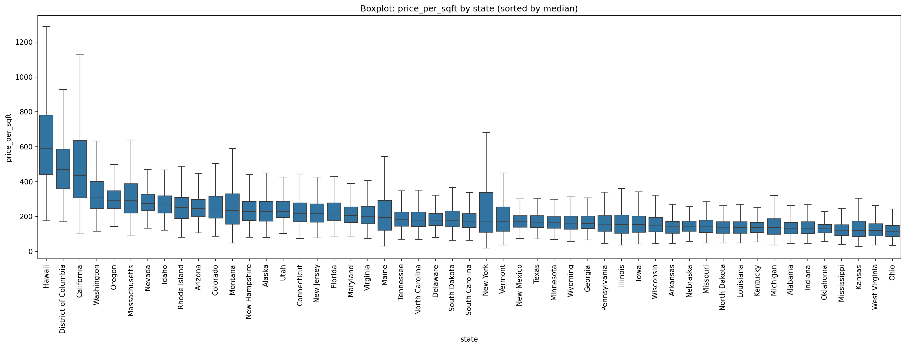
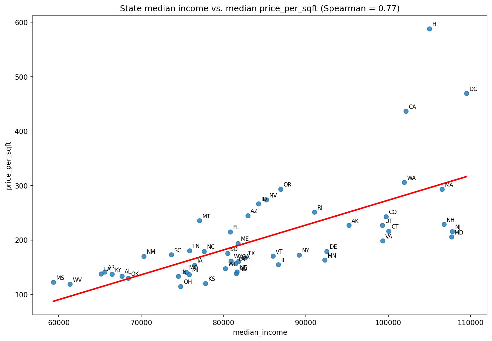
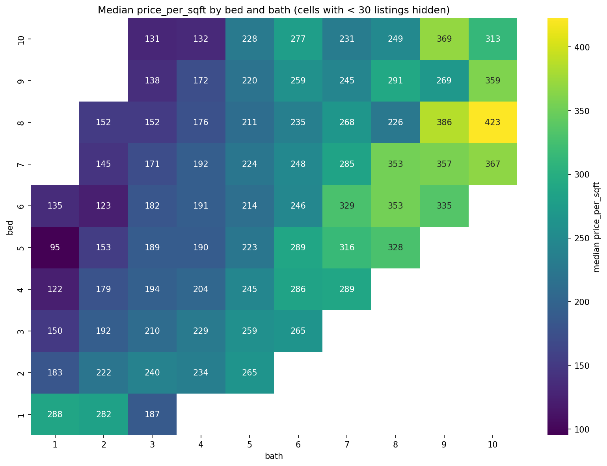

# 🏠 Real Estate Explorer

An interactive Streamlit app that answers one question:

> **In which US state is it more advantageous to buy a home, taking into account the price per square foot, the income level, the crime rate and the flood risk?**

**Live app:** real-estate-explorer-gumtipivqjstv59q3qb7xq

The app has four pages: **Home** (problem, data sources, cleaning, data preview), **EDA** (histogram, scatter plot, correlation heatmap, bedrooms × bathrooms heatmap), **Maps** (state maps and a regional comparison tool) and **Insights** (cheapest and most expensive states, what influences price per sqft, trade-offs, a multi-factor shortlist).

## Key findings

- **Location is the main driver of price per sqft:** the state alone explains about 47% of its variation.
- **Median income is the strongest contextual factor** (moderate across listings, strong across states).
- House size, bedrooms and bathrooms barely matter once the price is divided by square feet.
- **Crime and flood risk are weak or mixed signals.** For example, more flood-prone states tend to be cheaper per sqft, but large expensive markets (California, Florida) pull the listing-level number the other way.
- Cheapest states by median price per sqft: Ohio, West Virginia, Kansas. Most expensive: Hawaii, District of Columbia, California.

| Price per sqft by state | Income vs. price per sqft | Bedrooms × bathrooms |
|---|---|---|
|  |  |  |

## Data sources

| Data | Source | Year |
|---|---|---|
| Property listings | Kaggle, *USA Real Estate Dataset* (realtor.com listings), about 2.2 million rows | file dated July 2025 |
| `crime_rate` | FBI (UCR / Crime Data Explorer) via [USAFacts](https://usafacts.org/articles/which-states-have-the-least-and-most-crime/): violent + property crimes per 100,000 residents. Florida and North Dakota have incomplete 2025 reporting. | 2025 |
| `median_income` | U.S. Census Bureau, American Community Survey 2025 1-year estimates, brief [ACSBR-028](https://www2.census.gov/library/publications/2026/demo/acsbr-028.pdf) (median household income, 2025 dollars) | 2025 |
| `flood_risk` | OpenFEMA, DisasterDeclarationsSummaries v2: number of federal major disaster declarations linked to floods, hurricanes and tropical/coastal storms, scaled so the highest state = 100 | 2000–2025 |

`crime_rate`, `median_income` and `flood_risk` are state-level values: every listing in a state gets the same number.

## How the data was cleaned (`real_estate.py`)

| Step | Rows removed | Rows left |
|---|---|---|
| Raw file | | 2,226,382 |
| 1. Missing price, bed, bath, lot, city, ZIP or house size | 866,035 | 1,360,347 |
| 2. Keep the 50 states + DC only | 2,036 | 1,358,311 |
| 3. Duplicate listings (same street, city, state, ZIP, price, bed, bath): keep `sold`, then the latest sale date | 89,745 | 1,268,566 |
| 4. Price outside $50k–$10M | 16,514 | 1,252,052 |
| 5. House size outside 400–20,000 sqft | 982 | 1,251,070 |
| 6. Lot larger than 10 acres | 32,343 | 1,218,727 |
| 7. More than 10 bedrooms or bathrooms | 2,527 | 1,216,200 |
| 8. Inconsistent combinations (e.g. 1 bed with 10 baths) | 771 | 1,215,429 |
| 9. IQR rule on `price_per_sqft` (log scale, within each state) | 43,448 | **1,171,981** |

States are compared by the **median**, which is robust to expensive homes.

## Run it locally

```bash
pip install -r requirements.txt
streamlit run app.py
```

The cleaned data (`dsc.csv.gz`, about 20 MB) is included in the repository, so the app runs right away.

## Rebuild the data from scratch (optional)

1. Download the *USA Real Estate Dataset* from Kaggle and save it as `realtor-data.csv` next to `real_estate.py`.
2. Run `python real_estate.py`. It prints the number of rows before and after every cleaning step, writes `dsc.csv.gz` and saves all charts into `graphs/`.

## Repository structure

| File | What it is |
|---|---|
| `app.py` | the Streamlit app |
| `dsc.csv.gz` | cleaned dataset used by the app |
| `real_estate.py` | cleaning pipeline, state-level features and static charts |
| `graphs/` | static charts produced by `real_estate.py` |
| `requirements.txt` | Python packages |

## Limitations

- Crime, income and flood risk are state-level, so they say little about a specific city or neighborhood: use them as a first filter.
- `crime_rate` covers violent and property crimes only (the FBI's main index), not every kind of offense.
- Listing counts differ a lot between states, and the dataset is a snapshot, not a time series.
- The 10-acre limit removes about 2.5% of listings, mostly rural ones.
